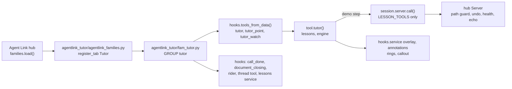

# How the Tutor plugs into Agent Link
<!-- SPDX-License-Identifier: LGPL-2.1-or-later -->

The Tutor teaches FreeCAD in the person's own window. It needs Agent Link for FreeCAD (the hub).
This page tells how it plugs into the hub. The hub's own flow is in [the hub's workflow pages](https://github.com/jamesK1000011/AgentLink-FreeCAD/blob/main/docs/workflow/README.md).

## How the hub finds it

- The hub loads any package on FreeCAD's path that holds `agentlink_families.py`. Here that is `agentlink_tutor/agentlink_families.py`. The hub never names this add-on.
- `AGENTLINK_API = ">=1,<2"`. `LICENSE = "LGPL-2.1-or-later"`.
- It registers the **Tutor** tab in the Agent Link panel (`hooks.register_tab("Tutor", …, order=15)`).

## Its tools and group

- One family: `agentlink_tutor/fam_tutor.py`, group `tutor`. It is not in the lean list. A session that never teaches pays for one row in `tool_groups`.
- The tools are data: `agentlink_tutor/data/tools.json`. `fam_tutor.tools(session)` binds them with `hooks.tools_from_data()`:
  - `tutor`: lessons in demo or guided mode (`agentlink_tutor/tool.py` `tutor()`).
  - `tutor_point`: numbered rings and a callout on controls, faces lit in 3D (`agentlink_tutor/point.py`).
  - `tutor_watch`: a long poll. `hooks.register_thread_tool("tutor_watch")` makes the window link answer it on its socket thread, so it never holds the GUI thread.
- `NO_ECHO = ("tutor",)`: the Tutor draws in the window itself, so the hub's echo shows nothing for these tools. The Activity tab still lists them.

## Hooks

- `hooks.on("call_done", …)`: the lesson in hand checks its step again after each call, the agent's or the person's (`live.call_done`).
- `hooks.on("document_closing", …)`: the lesson stops before its document closes.
- `hooks.register_rider("tutor", …)`: a line on each answer while a lesson runs.
- `hooks.watch_window("tutor")` with `command_used` and `workbench_activated`: the person's own clicks (`agentlink_tutor/observe.py`).
- `hooks.service("overlay")` and `hooks.service("annotations")`: the hub's rings, badges, callout and lit faces.
- `hooks.provide("lessons", …)`: other add-ons hand the Tutor a lessons folder by name.
- `hooks.register_reader("tutor_check", …)`: other add-ons add kinds of step check.

## How a lesson runs a step

- **Demo mode.** "Next" does the step through the hub's tools. `tool.call_for()` calls `session.server.call()`, as the agent's own calls go. The echo shows each call, and each change is one undo step.
- **Guided mode.** The person does the step. Its check runs again after each call, on the window's own signals, and on "Next".
- A lesson calls only tools in `LESSON_TOOLS` (`agentlink_tutor/lessons.py`): CAD, view, sketch and read tools. Every other tool is refused. `NEVER_CALLED` names more that never run in a lesson: `batch`, `job_start`, `gui_input`, `dialog_answer`, `addon`, `app_restart`, the `pref_` tools and others.
- The Tutor never moves the cursor, opens a menu for the person, or takes the focus.

## What it reads and writes

- **Reads.** The lessons: the Tutor's own and those of installed add-ons (`lessons/` beside their `agentlink_families` module, or their `LESSONS`). The FreeCAD document and the window, for each step's check.
- **Writes.** No files. The document changes only through the hub's tools in demo mode.

## Approvals

- The Tutor asks for no approval.
- A lesson cannot approve. It never calls a tool with `approve` in its name, nor `cookbook_` or `macro_` tools. The hub's `approve_code` and `approve_file` also refuse every call that does not come straight from the client.

## Diagram

